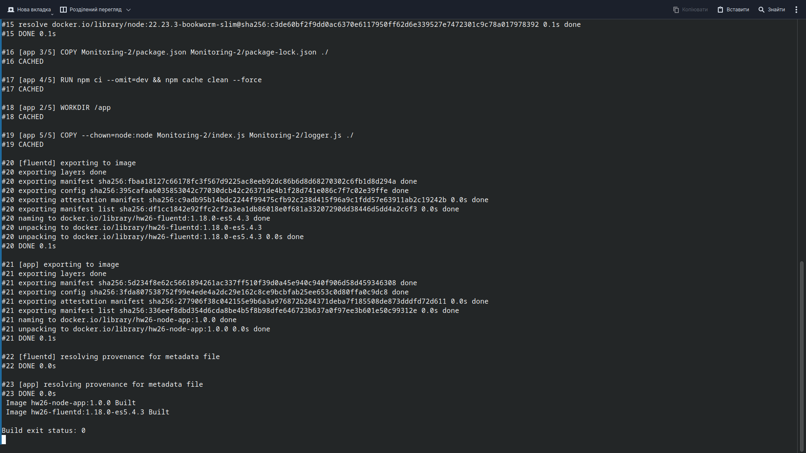
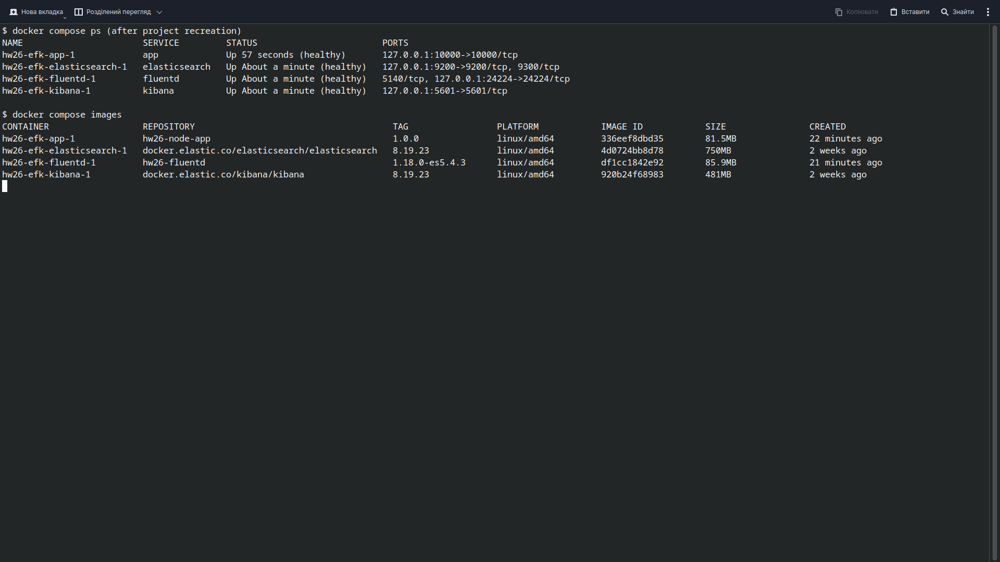
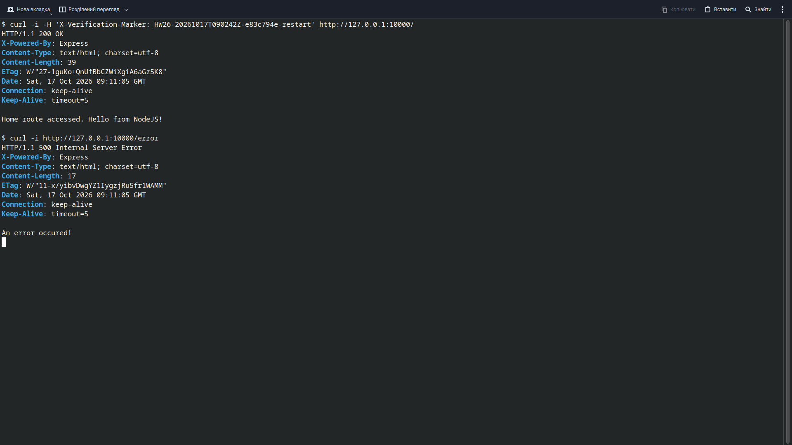
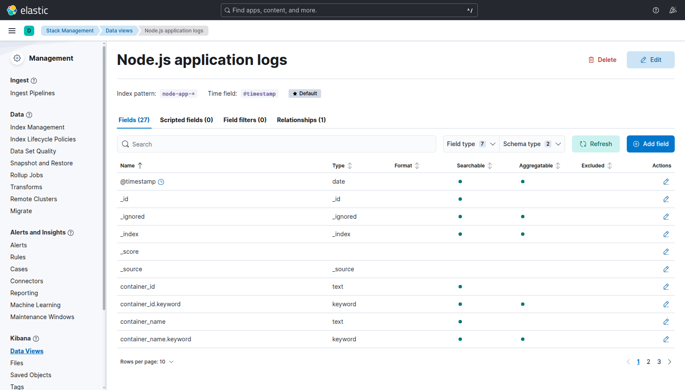
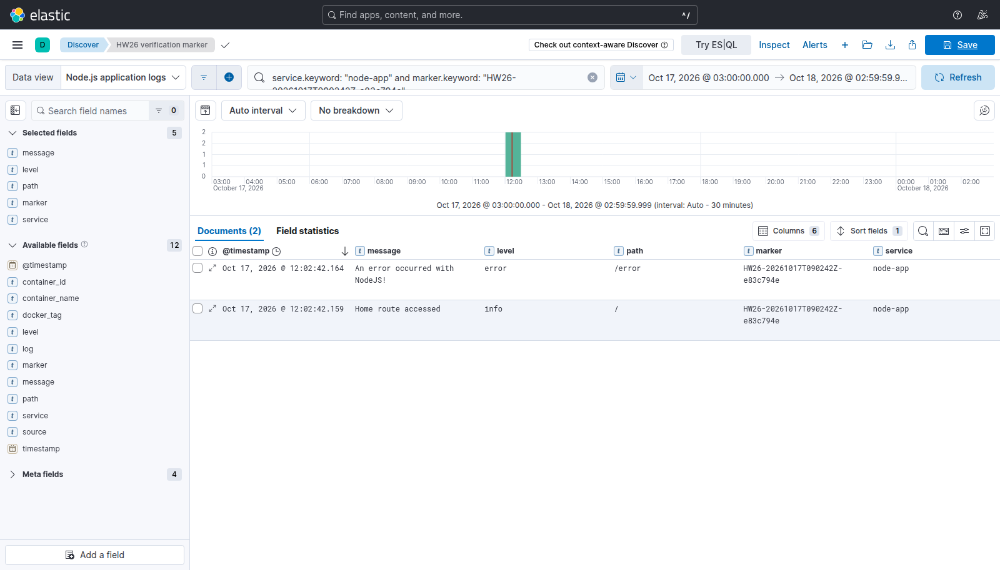
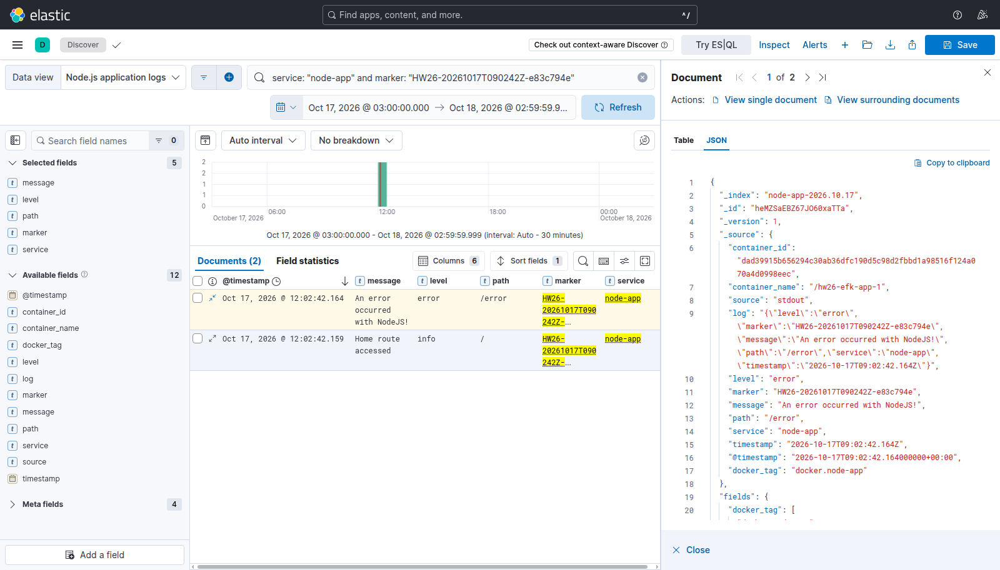
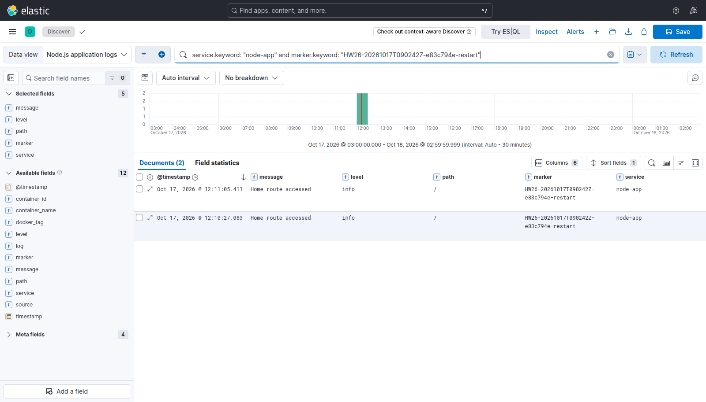

# HW26: Node.js logs in EFK

Runs a Node.js app in Docker and sends its logs to EFK: Elasticsearch, Fluentd and Kibana.
Logs go through these services:
Node.js → Docker logging driver → Fluentd → Elasticsearch → Kibana

## Requirements

You need Docker, Docker Compose, curl and a browser. Allow at least 4 GB of RAM for Docker. Ports `10000`, `9200`, `5601` and `24224` must be free.

The main image versions are:

- Node.js: `22.23.3-bookworm-slim`
- Elasticsearch and Kibana: `8.19.23`
- Fluentd: `v1.18.0-debian-1.0`
- Fluentd Elasticsearch plugin: `5.4.3`

This setup is for local practice. Authentication and TLS are disabled, and the ports are only available on `127.0.0.1`. It uses a local Docker daemon.

## Run the project

Open a terminal in the homework folder and run:

```bash
docker compose config --quiet
docker compose build
docker compose up -d --wait --wait-timeout 360
docker compose ps
```

Open these addresses:

- [Node.js app](http://127.0.0.1:10000/)
- [Error route](http://127.0.0.1:10000/error)
- [Kibana](http://127.0.0.1:5601/)
- [Elasticsearch](http://127.0.0.1:9200/)

The `/error` route returns HTTP 500 on purpose, so it can be used to create an error log.

## Create some logs

Run these commands to send two requests with the same marker:

```bash
MARKER="HW26-$(date -u +%Y%m%dT%H%M%SZ)"
echo "$MARKER"
curl -i -H "X-Verification-Marker: $MARKER" http://127.0.0.1:10000/
curl -i -H "X-Verification-Marker: $MARKER" http://127.0.0.1:10000/error
```

Wait a few seconds for the logs to reach Elasticsearch.

## View logs in Kibana

1. Open Kibana.
2. Go to **Stack Management → Data Views → Create data view**.
3. Enter `Node.js application logs` as the name.
4. Use `node-app-*` as the index pattern.
5. Select `@timestamp` as the time field and save.
6. Open **Discover** and select this Data View.
7. Choose a time range that includes your requests.

Search for your marker, replacing `YOUR_MARKER` with the value printed in the terminal:

```text
service.keyword: "node-app" and marker.keyword: "YOUR_MARKER"
```

You should see logs from both requests. Expand a record to see the message, level, path, marker and container details.

## Results

During the homework check, all four services became healthy. Logs from both routes appeared in Elasticsearch and Kibana Discover.

The marker used was `HW26-20261017T090242Z-e83c794e`, and the index was `node-app-2026.10.17`.

Logs were also checked after recreating the containers. The new marker ended in `-restart`. The old logs and Kibana Data View were still available because the volumes were kept.

Command outputs are in [evidence/](evidence/), including the [first log check](evidence/elasticsearch-marker.json) and the [check after restart](evidence/elasticsearch-after-restart.json).


## Stop and start again

To stop the containers:

```bash
docker compose stop
```

To start them again:

```bash
docker compose up -d --wait --wait-timeout 360
```

You can also use `docker compose down` to remove the project's containers and network. Do not add `-v` if you want to keep the logs and Kibana settings.

## If something does not work

Check the containers and service logs:

```bash
docker compose ps
docker compose logs --tail 100 elasticsearch fluentd kibana
```

If Discover is empty, check the Data View, time range and marker. Older logs will not appear in “Last 15 minutes”.

If Elasticsearch does not start, check available RAM, disk space and `vm.max_map_count`. The host used for this homework had `vm.max_map_count=1048576`.

## Screenshots

### 1. Image build



### 2. Running services



### 3. Application responses



### 4. Kibana Data View



### 5. Logs in Discover



### 6. Log details



### 7. Logs after restart



## Author 
Morphes

